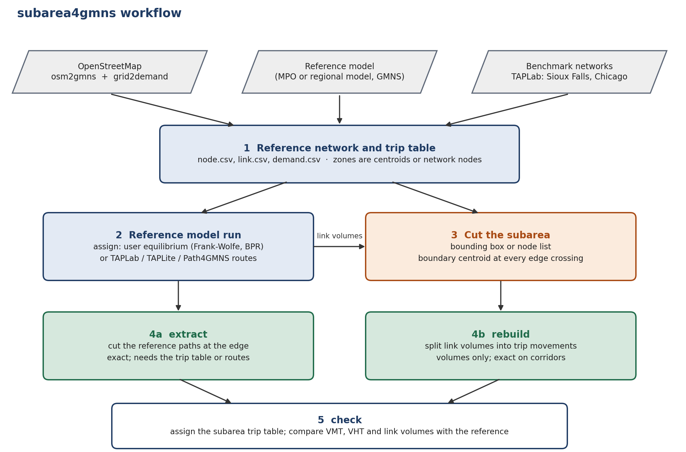

# subarea4gmns

**Build a subarea network and trip table from a reference travel model, and check them against it.**

[](https://github.com/asu-trans-ai-lab/subarea4gmns/actions/workflows/tests.yml)
[](LICENSE)


A corridor or district study usually starts from a larger model, such as an MPO model, a regional model, or a network built from OpenStreetMap with synthetic demand. The study needs a smaller network and its own trip table. That trip table is right only if it reproduces the larger model's traffic inside the study area.

`subarea4gmns` does three things on [GMNS](https://github.com/zephyr-data-specs/GMNS) files:

1. **Cut** a subarea by bounding box or node list. Every link that crosses the edge becomes a boundary zone.
2. **Build the subarea trip table**:
   - `extract`: cut the reference model's paths at the edge. Exact. Needs the reference trip table or route file.
   - `rebuild`: split the reference link volumes into trip movements. Needs volumes only; exact on corridor-type cuts.
3. **Check** it. Assign the trip table on the subarea and compare vehicle-miles, vehicle-hours and link volumes with the reference.



## Install

```bash
pip install git+https://github.com/asu-trans-ai-lab/subarea4gmns
# with the OpenStreetMap example tools
pip install "subarea4gmns[osm] @ git+https://github.com/asu-trans-ai-lab/subarea4gmns"
```

The only requirements are Python 3.9+, NumPy and SciPy. The OpenStreetMap example also uses [osm2gmns](https://github.com/asu-trans-ai-lab/OSM2GMNS) and [grid2demand](https://github.com/asu-trans-ai-lab/grid2demand).

## Quick start

```python
from subarea4gmns import read_network, read_demand, select_nodes, extract, check, write_demand

net = read_network("examples/sioux_falls/data")              # node.csv, link.csv
od = read_demand("examples/sioux_falls/data/demand.csv")      # o_zone_id, d_zone_id, volume
inside = select_nodes(net, node_ids=["8", "9", "10", "11", "14", "15", "16", "17", "22", "23"])

sub_od, summary, ref = extract(net, od, inside, "out/subarea")   # reference model + cut + trip table
write_demand(sub_od, "out/subarea/demand.csv")
result, links = check("out/subarea", sub_od)                       # assign it and compare
print(result["VMT_diff_pct"], result["link_WAPE_pct"])
```

The same steps from the command line:

```bash
subarea4gmns extract examples/sioux_falls/data out/subarea --bbox -96.80 43.48 -96.70 43.56
subarea4gmns check out/subarea out/subarea/demand.csv
```

## Examples

| Example | Reference model | Subarea | Check: VMT | Check: link error (WAPE) | Run time |
|---|---|---|---:|---:|---:|
| [`sioux_falls`](examples/sioux_falls) | 24 nodes, 76 links, 24 zones, 360,600 trips | 10 nodes, 26 links, 18 zones | +0.009% | 0.12% | 1 s |
| [`chicago_sketch`](examples/chicago_sketch) | 933 nodes, 2,950 links, 387 zones, 1.14 million trips | 98 nodes, 308 links, 58 zones | −0.015% | 0.39% | 1 min |
| [`openstreetmap`](examples/openstreetmap) | OpenStreetMap + grid2demand (ASU Tempe campus): 512 nodes, 55 zones | 190 nodes, 330 links, 39 zones | −0.02% | 0.21% | 1 min |
| [`corridor`](examples/corridor) | Link volumes only, 4-zone corridor | whole corridor | exact | 0% | instant |

Notes:

- **Check columns.** They compare the subarea assignment of the extracted trip table with the reference volumes on the subarea's physical links.
- **Sioux Falls and Chicago Sketch data.** These come from [TAPLab](https://github.com/asu-trans-ai-lab/TAPLab) (TNTP TransportationNetworks, research use).
- **Accuracy of the reference run itself.** The Chicago run lands within 27 vehicles RMSE of the published best-known equilibrium flows (mean flow 2,399).

## How it works

**Cut.** Links with both ends inside the subarea are kept. At each node where reference traffic crosses the edge, a boundary centroid is added with a connector in each direction that traffic crosses. Zones inside keep their IDs. Every subarea link carries the reference volume in `ref_volume`, and `zone.csv` lists each zone's entering and leaving volumes.

**Extract.** The reference model is solved by Frank-Wolfe, whose equilibrium is a weighted mix of shortest-path loadings. Each loading's paths are cut at the edge:

- a trip that starts or ends inside keeps its zone;
- a trip that crosses the edge uses the boundary centroid there;
- a path that leaves and comes back becomes two subarea trips.

The pieces carry the same weights as the equilibrium, so loading them reproduces the reference volumes inside the subarea exactly.

**Paths from another solver.** Route files from TAPLab, TAPLite/DTALite or Path4GMNS (`route_assignment.csv` with `node_sequence` or `link_sequence`) can be cut the same way with `extract_from_routes`.

**Rebuild (volumes only).** When only a loaded network is available, link volumes are split into trip movements, as sketched below. Each centroid's supply is its outgoing connector volume and its demand its incoming connector volume.

```
repeat until no link volume is left:
    take the link with the most unassigned volume
    find a path from a centroid with supply left, through that link, to another centroid
        with demand left, on links with volume left, never passing through a centroid
    assign min(volume left on the path, supply, demand) to that origin-destination pair
```

On a corridor this is exact. On a grid with alternative routes, link volumes do not determine the paths. The report then gives the share of volume explained (about 91% on central Chicago); use `extract` there.

**Assign and check.** Static user equilibrium with BPR travel times, solved by Frank-Wolfe with a line search. A centroid whose links are all connectors cannot be passed through; a zone on the street network, as in Sioux Falls, can. The check reports:

- vehicle-miles and vehicle-hours against the reference;
- link volume error (WAPE, R² and maximum difference) on physical links.

Details and formulas are in [docs/method.md](docs/method.md). [docs/demo.html](docs/demo.html) steps through the rebuild on a small corridor in a browser.

## Input conventions

| File | Required fields | Notes |
|---|---|---|
| `node.csv` | `node_id`, `x_coord`, `y_coord` | Zones: `zone_id`, or `node_type` = `centroid` |
| `link.csv` | `link_id`, `from_node_id`, `to_node_id`, `length`, `capacity`, `free_speed` | Optional: `lanes`, `link_type` (`*connector*` marks connectors), `vdf_fftt` / `VDF_fftt1` (minutes), `vdf_alpha`, `vdf_beta` |
| `demand.csv` | `o_zone_id`, `d_zone_id`, `volume` | Trips for the period |

- **Units.** The defaults are miles, mph, and capacity per link per hour. Use `length_unit="m"`, `speed_unit="kph"` and `capacity_per_lane=True` as your files require; osm2gmns output is meters, km/h and capacity per link.
- **Periods.** A period longer than one hour uses `hours=`, so capacity is scaled to the period.

## Limits

- **Reproduction is not validation.** The tools reproduce the reference model inside the subarea. Agreement with traffic counts is a separate question.
- **Static assignment.** Assignment is static user equilibrium with BPR costs, solved by plain Frank-Wolfe. That is accurate enough for subarea extraction on networks of a few thousand links. For tight equilibria or large models, solve the reference model with TAPLab, TAPLite/DTALite or Path4GMNS and use `extract_from_routes`.
- **Volume-only rebuild.** `rebuild` needs zones attached by connectors; it refuses zones on through nodes, whose trip ends cannot be read from link volumes. Its trip table is one of possibly many that fit the volumes; report results at link and corridor level.

## Related tools

- [GMNS](https://github.com/zephyr-data-specs/GMNS): the network format.
- [osm2gmns](https://github.com/asu-trans-ai-lab/OSM2GMNS): OpenStreetMap to GMNS.
- [grid2demand](https://github.com/asu-trans-ai-lab/grid2demand): synthetic zones and demand.
- [Path4GMNS](https://github.com/jdlph/Path4GMNS): path finding and assignment.
- [TAPLab](https://github.com/asu-trans-ai-lab/TAPLab): reproducible traffic assignment experiments and benchmark networks.

## License and data

- **Code:** MIT ([LICENSE](LICENSE)).
- **Sioux Falls** (`examples/sioux_falls/data`): from TAPLab TAPBench, originally TNTP TransportationNetworks (LeBlanc et al., 1975), research use.
- **Chicago Sketch:** downloaded from TAPLab by the example on first run (Eash et al., 1979), research use.
- **OpenStreetMap data:** © OpenStreetMap contributors, ODbL.

## Citation

See [CITATION.cff](CITATION.cff).
